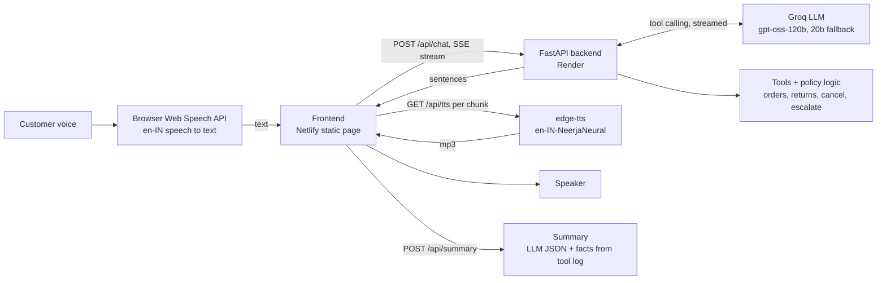

# Aria: AI Voice Customer Support Agent for Aura Skincare

A browser-based voice agent for a fictional D2C skincare brand. Click **Start Call**, talk to Aria, and she answers from the brand policies, looks up live (mock) orders through tool calls, refuses what policy doesn't allow, and produces a transcript plus a structured JSON outcome when the call ends. Everything runs on **free tiers**.

- **Live app:** https://aria-aura-voice.netlify.app/ (use desktop **Chrome or Edge**, allow the microphone, headphones recommended)
- **Backend API:** https://aria-voice-agent-105e.onrender.com
- **Demo video:** https://drive.google.com/drive/folders/1XMt1-Pq6Op4OXRtnZAhF9UBQjN78q2QH?usp=sharing (Note: Video takes few seconds to start as it processess)
- The backend runs on Render's free plan, so the first load can take up to a minute while it wakes up. The page shows "Waking up the server…" and enables **Start call** when it is ready.

## What Aria can do
| Requirement | How it is handled |
|---|---|
| Natural voice conversation | Browser speech recognition, streamed LLM replies, neural Indian-English voice, Hinglish supported |
| Brand knowledge and policies | Brand facts live in the system prompt (`backend/app/prompts.py`) |
| Order lookup | Tool calling: `get_order_details` plus `check_return_eligibility`, `cancel_order`, `escalate_to_human` |
| Policy enforcement | Eligibility is computed **in code** (`backend/app/tools.py`); the LLM only phrases the result |
| Out of scope or unknown | Polite refusal; says "I don't have that information" and can log a request for the team |
| Bad input | Unknown or missing order IDs, unclear audio and noise are handled without guessing |
| Post-call output | Transcript plus JSON outcome (`/api/summary`) |
| Testing UI | Start/End/Interrupt, Listening/Thinking/Speaking indicator, Test Orders panel, live transcript |

**Test orders:** `ORD-101` (Out for Delivery), `ORD-102` (Delivered 14 days ago), `ORD-103` (Processing, cancellable). They are shown on the page.

**Things to try:** "Where is order 101?", "Cancel ORD-103" then "yes", "Can I return ORD-102?", "I bought it 20 days ago and opened it, can I return it?", "Check order 999", "Book me a flight to Goa", "Mera order kahan hai?"

## Architecture


**Stack:** vanilla HTML/JS frontend (Netlify), Python FastAPI backend (Render), Groq LLM (`openai/gpt-oss-120b`, automatic fallback to `gpt-oss-20b`), `edge-tts` for the voice, Web Speech API for speech recognition.

### How a turn works
1. The browser transcribes the customer's speech (Chrome or Edge) and POSTs the text to `/api/chat`.
2. The backend streams the LLM response. If the model calls a tool, the backend runs it, returns the result to the model, and streams the final answer.
3. Tokens are cut into sentences and pushed to the browser as Server-Sent Events.
4. The browser fetches TTS for the first sentence immediately and batches the remaining sentences into one more call. Audio plays in order, and each line of text appears **when Aria starts saying it**, so text and voice stay in sync.
5. When the audio queue is empty, the browser listens again. **Interrupt** stops Aria mid-sentence.

### How the agent decides to use a tool
Every tool has a description and JSON schema sent with each request, and the system prompt says when to call them (order mentioned, return question, confirmed cancel). The model decides; the backend executes. The cancel tool is only called after an explicit confirmation turn.

### How guardrails are implemented (defence in depth)
- **Prompt:** brand facts as the only source of truth, plus rules (never promise refunds, only offer what she can do, say "I don't have that" instead of guessing, out of scope redirects).
- **Code:** return and cancel decisions are computed in `tools.py` (7-day window, opened or unopened, 48-hour damage window, cancel only while Processing). The model cannot talk its way into an exception, because the tool returns `eligible: false`.
- **Isolation:** each call gets its own copy of the orders, so cancelling ORD-103 in one call never affects the next tester.
- **Spoken order IDs** ("order one zero one", "ord 101", "1 0 1") are normalised before lookup, and unknown IDs return a structured not-found so the agent asks the customer to verify.
- **Free-tier protection:** per-IP rate limits, turn and time caps per call (20 turns, 5 minutes), no LLM call for noise like "um", automatic model fallback on rate limits.

## Project structure
```
backend/
  app/main.py        API: /health, /api/orders, /api/session, /api/chat (SSE), /api/tts, /api/summary
  app/llm.py         streaming turn loop, tool-calling loop, model fallback
  app/tools.py       tools + policy logic + order-ID normaliser
  app/prompts.py     persona, brand facts, guardrails
  app/summary.py     post-call JSON outcome
  app/tts.py         edge-tts wrapper with cache
  tests/             unit tests (no network) + scenarios.py (end-to-end guardrail checks)
frontend/index.html  the whole UI (no build step)
```

## Run it yourself
```bash
cd backend
python -m venv .venv && source .venv/bin/activate      # Windows: .venv\Scripts\activate
pip install -r requirements-dev.txt
cp .env.example .env                                    # add a free GROQ_API_KEY from console.groq.com
uvicorn app.main:app --reload                           # http://localhost:8000
```
In another terminal: `cd frontend && python -m http.server 5500`, open http://localhost:5500 in Chrome, and set `API` at the top of the script in `frontend/index.html` to `http://localhost:8000`.

**Environment variables** (see `backend/.env.example`): `GROQ_API_KEY`, `PRIMARY_MODEL`, `FALLBACK_MODEL`, `TTS_VOICE`, `ALLOWED_ORIGINS`, `MAX_TURNS`, `MAX_CALL_SECONDS`.

**Deploy:** backend on Render (Blueprint from `backend/render.yaml`, set `GROQ_API_KEY`); frontend folder on Netlify. A free UptimeRobot monitor pings `/health` every 5 minutes so the free server stays awake, and the page also warms the server on load.

## Testing
```bash
python -m pytest tests -q                                   # unit tests, no network
python tests/scenarios.py --base http://localhost:8000      # end-to-end guardrail checks with the real LLM
```
`scenarios.py` runs 13 conversations (order tracking, unknown ID, missing ID, cancel flow plus summary, refused cancel, return outside window, the 20-days-opened example, out of scope, unknown information, Hinglish, refund pressure, shipping fee, COD limit) and checks both the tools that were called and the wording of the replies. LLM output varies, so each failing scenario is retried once.

   The API allows 10 new sessions per IP per 10 minutes, so a full run (13+ sessions) is best split with
   `--from 7`, or run against a local server. Last full verification: all 13 scenarios passing.

## Known limitations
- Speech recognition uses the browser's Web Speech API, so desktop **Chrome or Edge** only (no iOS Safari or Firefox).
- Free-tier trade-offs: the server can be cold after idle time, and each reply takes roughly 2 to 3 seconds end to end. The first LLM sentence takes about 0.8 to 1.4 s and each TTS call about 1 s (roughly 1s TTS call and 0.8-1.4s ).
- Sessions live in server memory, so a restart ends active calls.
- Aria listens only after she finishes speaking (to avoid hearing herself on speakers). Interruption is a button, not automatic barge-in.

## Design questions

### 1. Why this architecture and stack?
I went with a modular pipeline (browser STT -> FastAPI backend with Groq -> edge-tts) because each piece has a reliable free tier and can be tested and tuned independently. An all-in-one speech-to-speech API would be lower latency, but free quotas are tight and model availability fluctuates too much for an open demo. FastAPI with Server-Sent Events makes streaming straightforward without needing websocket servers, and keeping the frontend static means the page loads immediately even if the free backend takes a few seconds to wake up. Most importantly, policy rules live in Python code rather than prompt instructions alone, ensuring return windows and cancellation rules are enforced consistently.

### 2. What was the hardest part, and how did I solve it?
Getting the conversation to feel snappy on free hosting. Early tests had noticeable delays: answers were too long, filler phrases added unnecessary latency, and the UI showed whole sentences before the audio even started. I smoothed this out by:
1. Shortening prompt instructions to strictly give 1-2 sentence spoken answers.
2. Dropping filler phrases since mock tool lookups are practically instantaneous.
3. Streaming TTS by sending the first sentence right away and batching the rest, while revealing transcript lines in sync with speech playback.

The other tricky part was preventing the model from overpromising. During edge testing, it occasionally tried to approve returns or make up store locations. Putting all return and cancellation math inside Python functions with explicit decline reasons kept the agent grounded.

### 3. With one more week, what would I improve first?
Latency and natural interruption. The browser speech recognition and HTTP-based TTS create a slight delay between turns. I'd migrate to WebSockets with server-side voice activity detection (VAD) so users can interrupt naturally mid-sentence without clicking a button or waiting out silence gaps. I'd also expand automated test scenarios to test against heavy accents, background noise, and adversarial prompts to catch prompt regressions automatically.

### 4. What would change at 1,000 conversations a day?
At that volume, the prototype's in-memory shortcuts wouldn't hold up. I'd make four key changes:

First, move session state out of RAM and into Redis or Postgres. Right now any server restart drops active calls. A persistent store also lets us log full transcripts and outcomes for analytics and QA.

Second, switch to paid, production-grade LLM and TTS endpoints with reserved concurrency, automated retries, and rate-limit headroom. The backend would move to always-on instances behind a load balancer, with latency and cost tracked per call.

Third, connect to real order systems with proper security. That means authenticating against real OMS/CRM APIs, verifying the customer's phone number or OTP before sharing order details, and scrubbing sensitive data (PII) from logs and transcripts.

Finally, replace the browser setup with real telephony. Users would dial in over standard phone lines (using SIP/PSTN through Twilio or LiveKit), backed by server-side voice activity detection for hands-free barge-in, plus continuous evaluation suites to catch prompt regressions before pushing updates.

